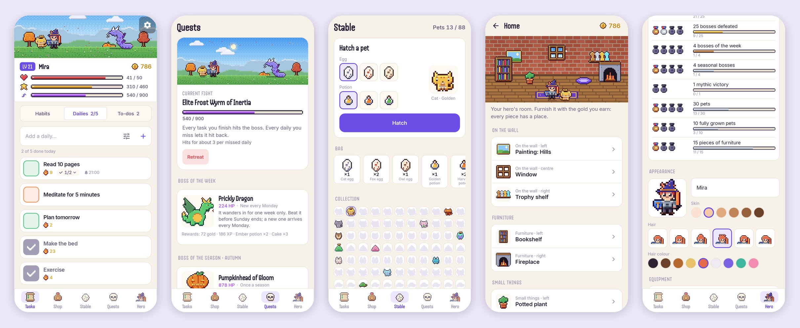
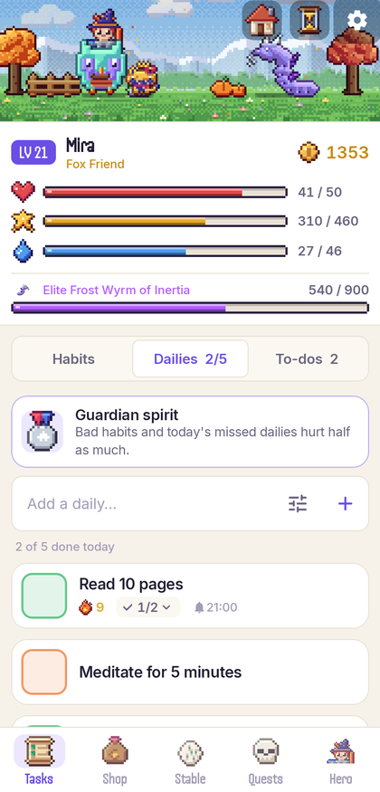
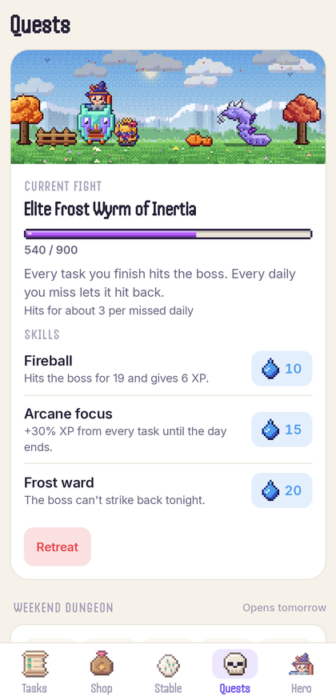
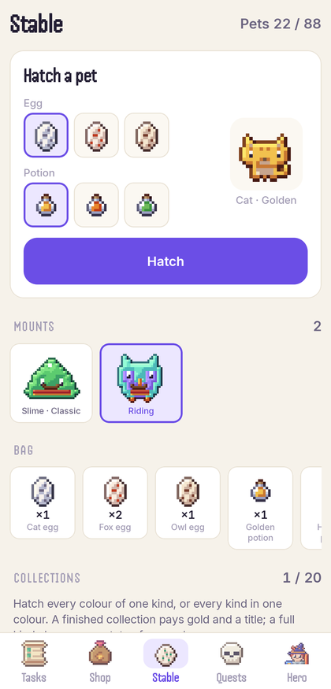
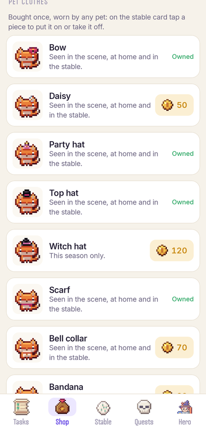
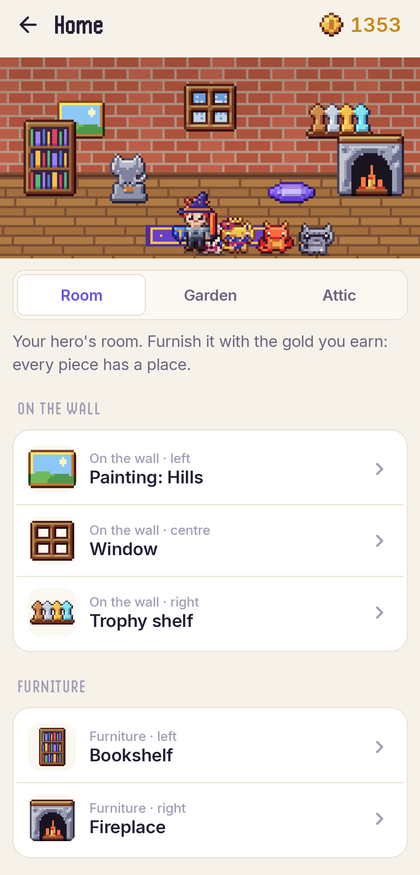
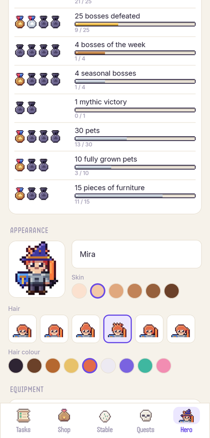

<div align="center">


# Dayquest

### Turn your days into a quest

*A habit RPG in the spirit of Habitica, with richer pixel art, a calmer interface and content that lasts for years. Free, no ads, no premium, no account.*

[](https://github.com/bigdevwhale/dayquest/actions/workflows/android.yml)
[](https://github.com/bigdevwhale/dayquest/releases/latest)


[](LICENSE)

**English** · [Русский](README.ru.md) · [Website](https://bigdevwhale.github.io/stillcraft/apps/dayquest/)



</div>

---

## The idea

Habits are easier to keep when something small and alive depends on them.

In Dayquest your habits, dailies and to-dos power a pixel hero. Finish things and the hero earns experience and gold, finds eggs and potions, hatches pets, furnishes a home and beats bosses. Miss your dailies and the hero gets hurt. Habitica made this idea famous. Dayquest keeps the idea and changes three things:

- **The art.** Still pixel art, but shaded like a pixel artist would: light from the top-left, hue-shifted ramps, coloured outlines, glowing magic, a living scene that follows the real time of day and the real season.
- **The pace.** Content is built to last for years instead of running out in two months: seasons, an endless forge, bosses that come back stronger, achievements that need real time, a home to furnish.
- **The price.** Everything is free. No account, no ads, no premium, no server: your hero lives on your phone and moves to another one with a file or a code.

## What it does

| | Feature | How it works |
|---|---|---|
| 🗡️ | **Habits, dailies, to-dos** | + / − habits, dailies on chosen weekdays or every N days, to-dos with due dates. Checklists open right in the list. Task colour shifts from red (neglected) to blue (mastered), and neglected tasks pay more. |
| 🌅 | **A living scene** | Your hero, pet and current boss stand in a pixel landscape with a dithered sky: dawn, noon, sunset, stars and fireflies at night. Six places to unlock, from a sunny meadow to a crystal cave. |
| ⚔️ | **Boss fights** | Every task you finish hits the boss, sometimes with a critical hit; every daily you miss lets it hit back. Damage numbers, sparks and coins fly in the scene. |
| 🐾 | **88 pets** | 8 species × 11 hatching potions. Pick an egg and a potion in one card and see who hatches. Feed them their favourite food until they are fully grown and wear a tiny crown. |
| 🛡️ | **Gear you can see** | Every helmet, robe, sword and shield changes both your stats and your sprite. The shop shows your hero *wearing* an item before you buy it. |
| ☀️ | **Kind mornings** | Before a new day starts, Dayquest asks which of yesterday's dailies you actually did. Night owls can move the day boundary up to 06:00. *Rest at the inn* pauses damage for holidays and sick days. |
| 🧭 | **A gentle start** | A five-page guide explains the game with its own art before you create your hero, each tab shows a one-time tip on your first visit, and *Settings → How to play* replays the guide. |
| ↩️ | **Undo anything** | Every tap shows what it gave (XP, gold, damage, drops) with an *Undo* button that reverts it exactly. |
| 🔔 | **Reminders** | Per-task reminder times and an evening "dailies still open" nudge. |
| 📊 | **History** | A 12-week activity heatmap, streaks, totals and a yearly chronicle. |

## Built for years, not weeks

Most habit games run out of things to unlock within a couple of months. Dayquest keeps going.

| | | |
|---|---|---|
| 🍂 | **Real seasons** | Blossom in spring, falling leaves in autumn, snow in winter, in every scene. Each season brings its own hatching potion (32 seasonal pets), a hat sold only then and a seasonal boss you can fight once per season. A switch flips seasons for the southern hemisphere. |
| 🔨 | **The endless forge** | From level 20, every 5 levels a new tier of gear appears, from rare to epic to legendary. Items are generated from their tier, so the forge never runs dry, and the prices keep gold meaningful. |
| 💀 | **Bosses that come back** | Beaten bosses return as Elite, Ancient and Mythic versions: recoloured, tougher, with richer loot. A new generated *boss of the week* wanders in every Monday. |
| 🏅 | **Achievements that need time** | 47 achievements, from a 7-day streak to *five years together*, each with a gold reward. They measure real days, not grinding. |
| 🏠 | **A home** | 27 pieces of furniture plus wallpapers and floors for the hero's room. The fireplace, lamp and candles glow at night, the window shows the real sky, and the pet sleeps in its bed. |

## Screenshots

| Tasks | Boss fight | Stable | Shop | Home | Achievements |
|:-:|:-:|:-:|:-:|:-:|:-:|
|  |  |  |  |  |  |

## No account: move your hero with a file or a code

Everything stays on the phone. To continue on another device, open **Settings → Move your progress** and:

- **Send file** or **Save file**: a JSON file for any messenger, cloud drive or USB stick;
- **Copy code**: one line of text (`DQ1:…`) to paste into Dayquest on the other phone.

On the new phone choose **I already have a hero** on the welcome screen. Where Google backup is available, Android's own device backup carries the database over too.

## Pixel art that isn't flat

All sprites are drawn from small grids and shapes by a tiny engine in `pixel/`, which shades them the way a pixel artist would:

- light from the top-left with contact shadows where one material overlaps another;
- hue-shifted 5-tone ramps: cool violet shadows, warm highlights;
- coloured outlines instead of black ones, and a glow halo for enchanted items;
- a dithered sky that follows the real clock, parallax hills, clouds, stars and particles;
- the scene renders at about 170×72 pixels and is scaled by a whole number, so every pixel stays a crisp square on any screen.

Since everything is generated, a new boss, pet colour or forge tier is a line in the catalog, not a new drawing. That is what makes the long game possible without a team behind it.

## Download

Get the APK from **[Releases](https://github.com/bigdevwhale/dayquest/releases/latest)**, or the debug APK attached to any [CI run](https://github.com/bigdevwhale/dayquest/actions/workflows/android.yml).
Android 8.0 (API 26) or newer.

> [!TIP]
> On Xiaomi (MIUI / HyperOS), Huawei and some other phones the system kills background apps and drops their alarms.
> If reminders arrive late, allow **Autostart** for Dayquest and set battery usage to **No restrictions**. *Settings → Reminders don't arrive?* opens the right screen.

## English & Русский

Every screen, boss, item and achievement is translated, with proper Russian plurals and adjectives that agree with forged item names. Switch in **Settings → Language**; on Android 13+ the app also appears in the system's per-app language settings.

## Under the hood

- **Kotlin + Jetpack Compose**, Material 3 with a custom palette (light and dark), Inter for text and the Handjet pixel font for headings.
- **Room** for tasks, checklists, history, hero, items and pets · **DataStore** for settings.
- The rules (XP curve, task value, damage, drops, day rollover, forge, boss ranks, seasons, achievements) are pure Kotlin in `game/`, covered by unit tests.
- **AlarmManager** (`setAndAllowWhileIdle`, no exact-alarm permission): one alarm at the next reminder, re-armed on boot and app start.

```
app/src/main/java/app/dayquest/
├── game/     rules, catalog, forge, seasons, achievements, home, the Game engine (pure Kotlin)
├── pixel/    shading engine, sprites, the living scene, the room
├── data/     Room database, DataStore settings, JSON backup and transfer code
├── notify/   reminders and the evening nudge
└── ui/       theme, components, tasks · shop · stable · quests · hero · home · settings · onboarding
```

## Build from source

Requirements: JDK 17+ (Android Studio's bundled JBR works) and the Android SDK.

```bash
git clone https://github.com/bigdevwhale/dayquest.git
cd dayquest
./gradlew testDebugUnitTest            # unit tests
./gradlew assembleDebug                # app/build/outputs/apk/debug/app-debug.apk
./gradlew installDebug                 # app.dayquest.dev, installed next to the release
./gradlew installDebug -Pdemo          # app.dayquest.demo with a mid-game hero, next to the real app
./gradlew testDebugUnitTest -Ppreview=/tmp/sheets   # render sprite sheets, scenes and rooms to PNG
```

### CI / releases

- **Android CI** (`.github/workflows/android.yml`): on every push and PR runs unit tests and lint (missing translations fail the build) and uploads a debug APK.
- **Release** (`.github/workflows/release.yml`): push a tag like `v1.0.0` (or run it manually) to build a signed release APK and publish it as a GitHub Release.

## License

[MIT](LICENSE) · Inter and [Handjet](https://fonts.google.com/specimen/Handjet) under the SIL Open Font License 1.1.

Inspired by [Habitica](https://habitica.com). Dayquest is an independent project and shares no code or art with it.
