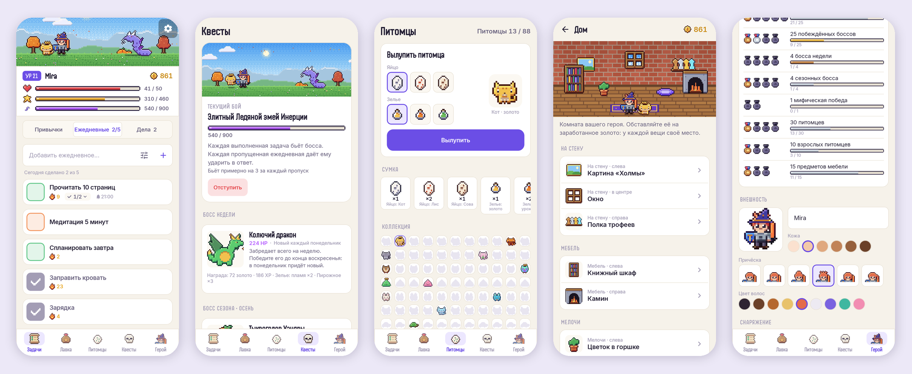
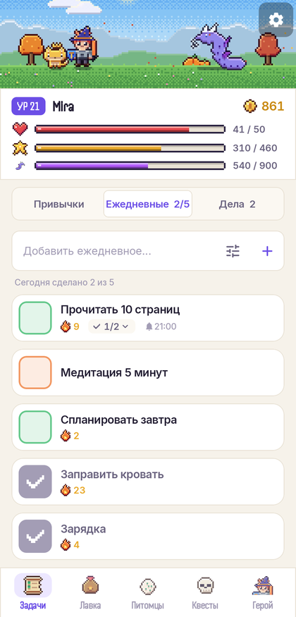
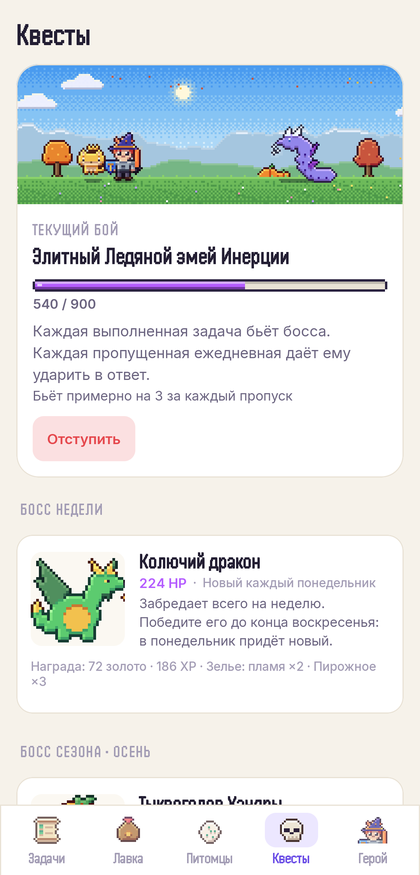
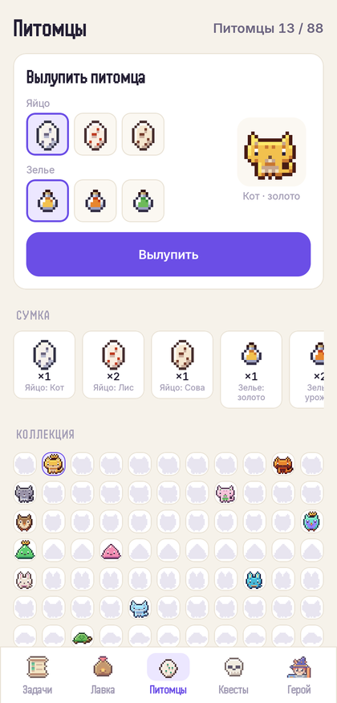
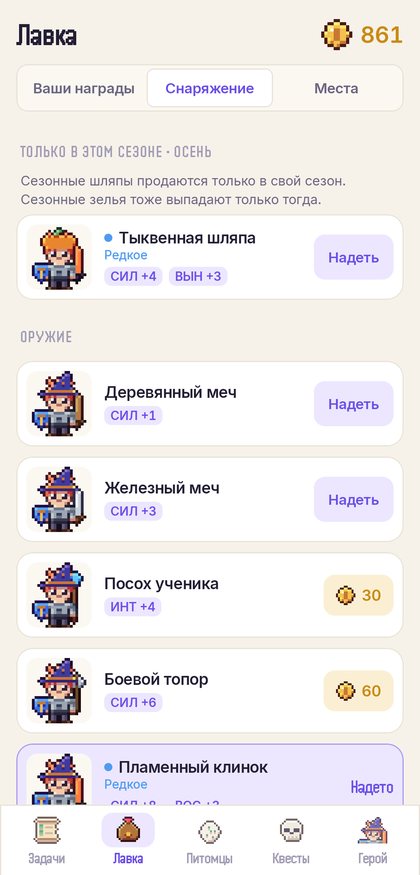
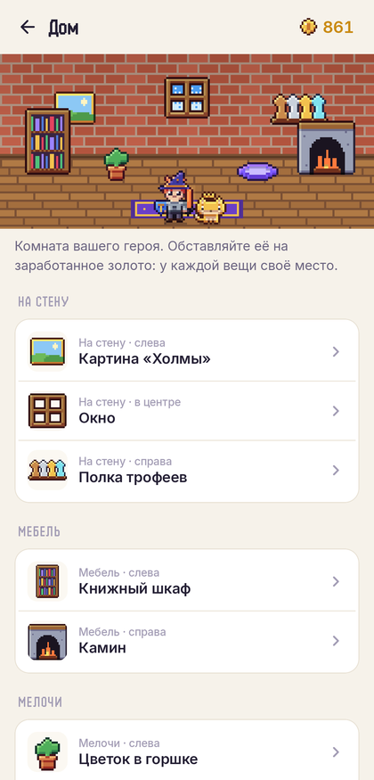
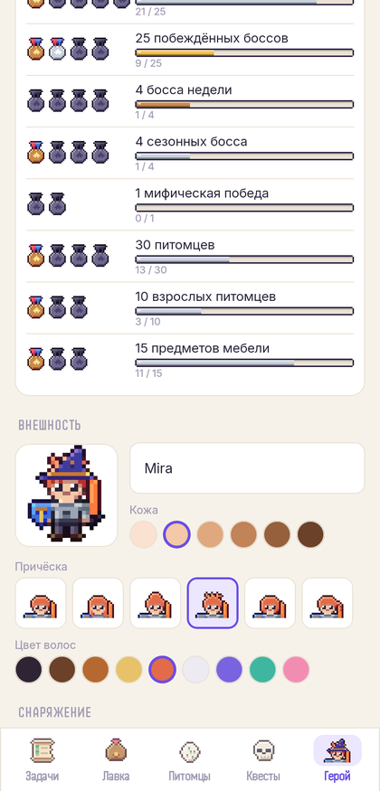

<div align="center">


# Dayquest

### Превратите свои дни в приключение

*RPG для привычек в духе Habitica: более красивый пиксель-арт, спокойный интерфейс и контент, которого хватит на годы. Бесплатно, без рекламы, премиума и аккаунта.*

[](https://github.com/bigdevwhale/dayquest/actions/workflows/android.yml)
[](https://github.com/bigdevwhale/dayquest/releases/latest)


[](LICENSE)

[English](README.md) · **Русский** · [Сайт](https://bigdevwhale.github.io/stillcraft/apps/dayquest/)



</div>

---

## Идея

Привычки держать легче, когда от них зависит что-то маленькое и живое.

В Dayquest ваши привычки, ежедневные задачи и дела двигают пиксельного героя. Делаете — герой получает опыт и золото, находит яйца и зелья, выводит питомцев, обставляет дом и побеждает боссов. Пропускаете ежедневные — герою больно. Идею прославила Habitica. Dayquest её сохраняет и меняет три вещи:

- **Графика.** По-прежнему пиксель-арт, но с настоящей светотенью: свет сверху-слева, цветные тени, цветные контуры, светящаяся магия и живая сцена, которая следует реальному времени суток и сезону.
- **Темп.** Контент рассчитан на годы, а не на два месяца: сезоны, бесконечная кузница, боссы, которые возвращаются сильнее, достижения за реальное время, дом.
- **Цена.** Всё бесплатно. Ни аккаунта, ни рекламы, ни премиума, ни сервера: герой живёт на вашем телефоне и переезжает на другой файлом или кодом.

## Что умеет

| | Возможность | Как работает |
|---|---|---|
| 🗡️ | **Привычки, ежедневные, дела** | Кнопки + / −, расписание по дням недели или раз в N дней, сроки. Чек-листы раскрываются прямо в списке. Цвет задачи меняется от красного (запущена) к синему (освоена), запущенные задачи приносят больше. |
| 🌅 | **Живая сцена** | Герой, питомец и текущий босс стоят в пиксельном пейзаже с дизерингованным небом: рассвет, полдень, закат, звёзды и светлячки ночью. Шесть мест — от солнечного луга до хрустальной пещеры. |
| ⚔️ | **Бои с боссами** | Каждая сделанная задача бьёт босса, иногда критом; каждая пропущенная ежедневная даёт ему ударить в ответ. В сцене летят цифры урона, искры и монеты. |
| 🐾 | **88 питомцев** | 8 видов × 11 инкубационных зелий. Яйцо и зелье выбираются в одной карточке, сразу видно, кто вылупится. Любимая еда растит питомца, пока он не вырастет и не наденет корону. |
| 🛡️ | **Снаряжение видно на герое** | Каждый шлем, мантия, меч и щит меняют и характеристики, и спрайт. В лавке героя можно примерить до покупки. |
| ☀️ | **Мягкое утро** | Перед новым днём Dayquest спрашивает, какие вчерашние задачи вы всё-таки сделали. Совам — сдвиг начала дня до 06:00. «Отдых в таверне» отключает урон в отпуске и на больничном. |
| ↩️ | **Отмена всего** | После каждого действия видно, что оно дало (опыт, золото, урон, находки), и есть кнопка «Отменить», которая возвращает всё в точности. |
| 🔔 | **Напоминания** | Время напоминания у каждой задачи и вечерняя проверка «ежедневные ещё не сделаны». |
| 📊 | **История** | Тепловая карта за 12 недель, серии, итоги и летопись по годам. |

## Рассчитано на годы

| | | |
|---|---|---|
| 🍂 | **Настоящие сезоны** | Весной цветение, осенью листопад, зимой снег — во всех сценах. В каждом сезоне своё зелье (32 сезонных питомца), шляпа, которая продаётся только тогда, и сезонный босс раз в сезон. Есть переключатель для южного полушария. |
| 🔨 | **Бесконечная кузница** | С 20 уровня каждые 5 уровней появляется новый ранг снаряжения: редкое, эпическое, легендарное. Вещи генерируются по рангу, поэтому кузница не кончается, а цены держат золото ценным. |
| 💀 | **Боссы возвращаются** | Побеждённые боссы приходят снова элитными, древними и мифическими: в новых цветах, сильнее и с лучшей добычей. Каждый понедельник появляется новый сгенерированный «босс недели». |
| 🏅 | **Достижения за время** | 47 достижений — от серии в 7 дней до «пяти лет вместе», каждое с наградой золотом. Они считают реальные дни, а не гринд. |
| 🏠 | **Дом** | 27 предметов мебели, обои и полы для комнаты героя. Ночью светятся камин, лампа и свечи, в окне настоящее небо, а питомец спит на лежанке. |

## Скриншоты

| Задачи | Бой | Питомцы | Лавка | Дом | Достижения |
|:-:|:-:|:-:|:-:|:-:|:-:|
|  |  |  |  |  |  |

## Без аккаунта: герой переезжает файлом или кодом

Всё хранится на телефоне. Чтобы продолжить на другом устройстве, откройте **Настройки → Перенос прогресса** и:

- **Отправить файл** или **Сохранить файл** — JSON для любого мессенджера, облака или флешки;
- **Скопировать код** — одна строка (`DQ1:…`), которую нужно вставить в Dayquest на другом телефоне.

На новом телефоне на приветственном экране выберите «У меня уже есть герой». Там, где есть резервное копирование Google, базу переносит и сам Android.

## Скачать

APK — на странице **[Releases](https://github.com/bigdevwhale/dayquest/releases/latest)** или debug-сборка в любом [запуске CI](https://github.com/bigdevwhale/dayquest/actions/workflows/android.yml). Android 8.0 (API 26) или новее.

> [!TIP]
> На Xiaomi (MIUI / HyperOS), Huawei и некоторых других телефонах система останавливает фоновые приложения и сбрасывает их будильники.
> Если напоминания опаздывают, разрешите Dayquest **автозапуск** и снимите **ограничения батареи**. Нужный экран открывает *Настройки → Не приходят напоминания?*

## Сборка

```bash
git clone https://github.com/bigdevwhale/dayquest.git
cd dayquest
./gradlew testDebugUnitTest      # тесты
./gradlew assembleDebug          # APK
./gradlew installDebug -Pdemo    # app.dayquest.demo с готовым героем для скриншотов
```

Kotlin, Jetpack Compose, Room, DataStore. Подробнее об устройстве — в [английском README](README.md#under-the-hood).

## Лицензия

[MIT](LICENSE) · шрифты Inter и [Handjet](https://fonts.google.com/specimen/Handjet) под SIL Open Font License 1.1.

Вдохновлено [Habitica](https://habitica.com). Dayquest — независимый проект, не использующий её код и графику.
